# CHƯƠNG 1. GIỚI THIỆU

## 1.1 Phát biểu bài toán

Theo Báo cáo Thế giới về Thị lực của Tổ chức Y tế Thế giới, có ít nhất 2,2 tỷ người trên thế giới bị suy giảm thị lực gần hoặc xa [1]. Với người mù và người thị lực kém, việc đi vào một tòa nhà lạ là một thử thách: người sáng mắt chỉ cần nhìn qua bảng sơ đồ ở sảnh là hình dung được bố cục, còn người khiếm thị phải hỏi đường, ghi nhớ lời chỉ dẫn hoặc tự dò tìm.

Bản đồ xúc giác (tactile map) là công cụ lấp khoảng trống này. Đây là bản đồ có các đường và ký hiệu nổi, kèm chữ nổi braille, để người đọc cảm nhận bố cục tòa nhà bằng đầu ngón tay. Đọc một lần ở lối vào, người dùng biết hành lang dẫn đi đâu, cầu thang và thang máy nằm ở đâu, cửa nào là cửa mình cần tìm. Tuy vậy, gần như rất ít tòa nhà có bản đồ như vậy. Lý do là mỗi bản đồ phải được đặt làm riêng: chuyên gia nghiên cứu bản vẽ, thiết kế bố cục theo tiêu chuẩn đồ họa xúc giác, sản xuất rồi giao hàng. Quy trình này chậm, tốn kém và cần kiến thức chuyên môn mà phần lớn thư viện, bảo tàng, trường học hay văn phòng không có.

Trong khi đó, máy in 3D phổ thông đã có mặt ở nhiều trường học, thư viện và xưởng chế tạo, đủ khả năng in ra một tấm nhựa có chi tiết nổi chính xác đến dưới một milimét. **Điểm nghẽn không còn là khâu sản xuất mà là khâu thiết kế.**

Mặt khác, các mô hình ngôn ngữ lớn đa phương thức (MLLM) như Gemini, Claude hay Qwen-VL có thể "nhìn" một bức ảnh và mô tả nội dung của nó dưới dạng dữ liệu có cấu trúc. Điều này mở ra khả năng tự động đọc một bản vẽ mặt bằng. Nhưng MLLM cũng có nhược điểm: kết quả không ổn định giữa các lần chạy, có thể bỏ sót hoặc "bịa" ra phần tử, và không có gì bảo đảm rằng kích thước, khoảng cách do mô hình tạo ra tuân thủ tiêu chuẩn xúc giác. Một bản đồ xúc giác sai còn nguy hiểm hơn không có bản đồ, vì người đọc không thể tự đối chiếu bằng mắt.

Bài toán của khóa luận được phát biểu như sau:

> **Đầu vào:** một ảnh sơ đồ mặt bằng 2D của một tầng tòa nhà (PNG, JPG hoặc WebP).
> **Đầu ra:** tệp STL của một tấm bản đồ xúc giác 200 × 200 mm và một tấm chú giải chữ nổi, in được ngay trên máy in 3D phổ thông, tuân thủ các thông số của hướng dẫn BANA 2022 và tiêu chuẩn ADA §703.
> **Ràng buộc:** người dùng không cần biết thiết kế CAD; mọi phần tử mà AI không chắc chắn phải được đưa ra cho con người kiểm tra; mọi kích thước vật lý phải do mã tất định quyết định chứ không do mô hình AI.

## 1.2 Mục tiêu nghiên cứu

Đề tài hướng tới các mục tiêu sau:

1. **Xây dựng một hệ thống web hoàn chỉnh** cho phép người dùng đi hết quy trình: tải ảnh lên → AI đọc sơ đồ → kiểm tra, chỉnh sửa → xem trước 3D → tải tệp STL.
2. **Ứng dụng mô hình ngôn ngữ lớn đa phương thức** để trích xuất có cấu trúc các phần tử của sơ đồ mặt bằng (tường, cửa, phòng, ký hiệu) kèm độ tin cậy, và để chỉnh sửa dữ liệu theo câu lệnh ngôn ngữ tự nhiên.
3. **Thiết kế một định dạng dữ liệu trung gian duy nhất (FloorModel)** dùng chung giữa giao diện, máy chủ và các tác tử AI, có kiểm tra kiểu chặt chẽ.
4. **Xây dựng bộ chuyển đổi xúc giác tất định**, mã hóa các tiêu chuẩn BANA 2022 và ADA §703 thành hằng số, sinh hình học 3D và tự động cảnh báo các vi phạm.
5. **Đánh giá thực nghiệm** chất lượng trích xuất của một số mô hình AI khác nhau, hiệu năng và chi phí của hệ thống.

## 1.3 Phạm vi nghiên cứu

**Bảng 1.1. Phạm vi chức năng của đề tài**

| Trong phạm vi | Ngoài phạm vi (chưa thực hiện) |
|---|---|
| Ảnh raster PNG/JPG/WebP, tối đa 10 MB, một tầng | Tệp PDF, bản vẽ CAD (DWG/DXF) |
| Tường, cửa, phòng có nhãn, 4 loại ký hiệu: cầu thang, thang máy, lối vào, nhà vệ sinh | Đồ nội thất, cửa sổ, lối đi ngoài trời |
| Một tấm bản đồ 200 × 200 mm và một tấm chú giải | Bản đồ nhiều tấm cho tòa nhà lớn |
| Cảnh báo vi phạm tiêu chuẩn | Tự động sửa vi phạm |
| Chữ nổi cấp 1 (không rút gọn) cho chữ cái Latinh a–z và chữ số | Chữ nổi tiếng Việt có dấu, chữ nổi rút gọn |
| Đăng nhập Google tùy chọn ở giao diện | Phân quyền, quản lý tài khoản, dự án riêng theo người dùng |

**Đối tượng sử dụng:** (1) nhân viên phụ trách hỗ trợ tiếp cận tại thư viện, bảo tàng, trường học, văn phòng, là người tạo bản đồ; (2) người mù và người thị lực kém, là người đọc bản đồ in ra.

**Giới hạn:** đề tài không huấn luyện mô hình nhận dạng sơ đồ mới mà sử dụng các MLLM có sẵn qua API. Đề tài được thực hiện bởi một sinh viên trong khoảng thời gian từ 10/09/2026 đến 01/01/2027.

## 1.4 Phương pháp tiếp cận

### 1.4.1 Mô hình phát triển phần mềm

Đề tài áp dụng mô hình **Agile theo các sprint hai tuần**, điều chỉnh cho quy mô một người. Lý do chọn Agile thay cho Waterfall là chất lượng đầu ra của MLLM khó dự đoán trước: cần làm ra sản phẩm chạy được sớm, thử với ảnh thật, rồi mới điều chỉnh prompt và quy tắc chuẩn hóa. Mỗi sprint kết thúc bằng một buổi demo với giảng viên hướng dẫn.

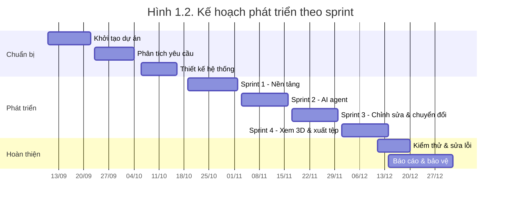

### 1.4.2 Phương pháp thiết kế hệ thống

Thiết kế hệ thống dựa trên nguyên tắc cốt lõi: **"AI đề xuất, mã tất định quyết định"** (AI proposes, deterministic code disposes):

- Mô hình AI **chỉ đọc** bản vẽ và đề xuất nội dung (có gì, ở đâu, chắc chắn đến mức nào).
- Con người **xác nhận** nội dung đó trên trình chỉnh sửa.
- Mã tất định **quyết định** mọi thứ liên quan đến kích thước vật lý: độ cao, độ rộng, khoảng cách, hình học chữ nổi. Các tiêu chuẩn là hằng số trong mã, không bao giờ nằm trong prompt.

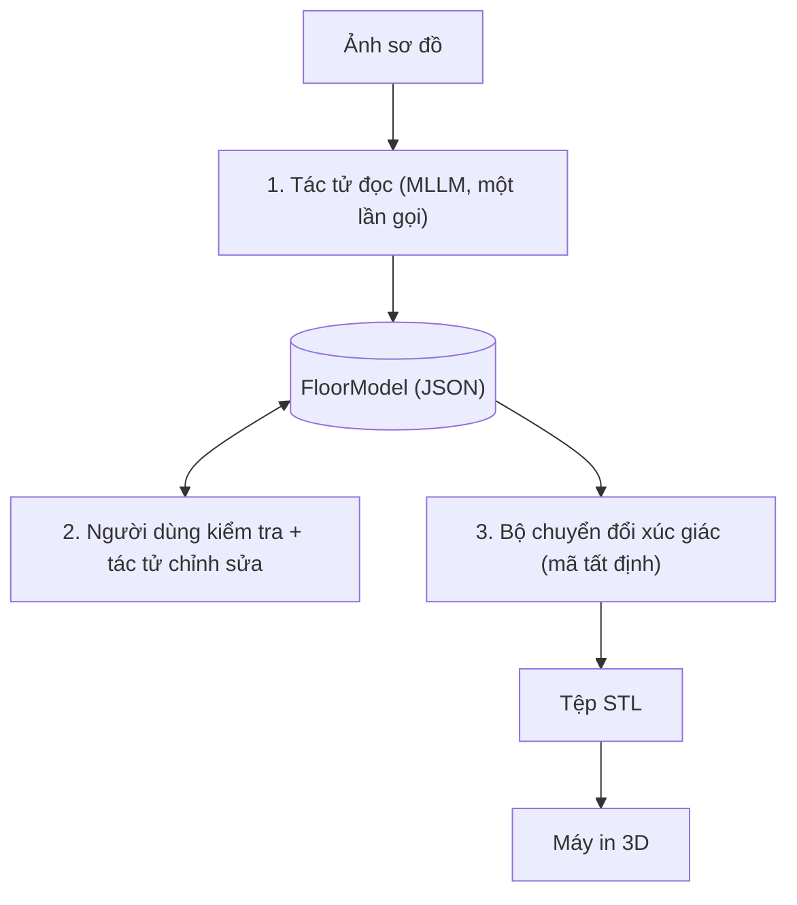
*Hình 1.1. Quy trình tổng quát của hệ thống*

Ngoài ra, đề tài áp dụng các phương pháp: nghiên cứu tài liệu (tiêu chuẩn BANA, ADA, tài liệu API của các mô hình), thực nghiệm so sánh (chạy cùng một sơ đồ với nhiều mô hình), và thiết kế hướng dữ liệu (định nghĩa FloorModel trước, xây dựng các thành phần xung quanh sau).

## 1.5 Đóng góp của khóa luận

1. **Một hệ thống hoạt động đầy đủ**, mã nguồn mở, chạy được cục bộ chỉ với hai lệnh (`bun run setup`, `bun run dev`), có chế độ thử với dữ liệu mẫu không cần khóa API.
2. **Một kiến trúc tách bạch AI và phần tất định** cho bài toán có yêu cầu an toàn: AI không thể âm thầm tạo ra một bản đồ không đọc được, vì mọi kích thước đều do mã quyết định và mọi vi phạm đều được cảnh báo.
3. **Cơ chế độ tin cậy kết hợp con người trong vòng lặp** (human-in-the-loop): mỗi phần tử AI tạo ra có độ tin cậy, phần tử dưới ngưỡng 0,7 được đánh dấu và có nút "xem tiếp" để duyệt lần lượt.
4. **Bộ sinh hình học xúc giác gọn nhẹ** (khoảng 440 dòng TypeScript) không phụ thuộc thư viện CAD: sinh tường có khe cửa, bốn ký hiệu chuẩn, chấm braille hình chỏm cầu, dấu định hướng, và xuất STL nhị phân.
5. **Số liệu thực nghiệm** so sánh năm mô hình đa phương thức trên cùng một sơ đồ, cho thấy sự khác biệt về số phần tử trích xuất, cách tự đánh giá độ tin cậy, độ ổn định giữa các lần chạy và chi phí.

## 1.6 Cấu trúc khóa luận

Ngoài phần mở đầu, tài liệu tham khảo và phụ lục, khóa luận gồm năm chương:

- **Chương 1 – Giới thiệu:** phát biểu bài toán, mục tiêu, phạm vi, phương pháp và đóng góp.
- **Chương 2 – Cơ sở lý thuyết và công nghệ liên quan:** hệ thống thông tin, kiến trúc phần mềm, mô hình ngôn ngữ lớn đa phương thức, tiêu chuẩn đồ họa xúc giác và chữ nổi, các công nghệ sử dụng và các hệ thống tương tự.
- **Chương 3 – Phân tích và thiết kế hệ thống:** yêu cầu, mô hình nghiệp vụ, kiến trúc, cơ sở dữ liệu và giao diện.
- **Chương 4 – Triển khai hệ thống và thực nghiệm:** môi trường, cài đặt, triển khai, kiểm thử và đánh giá.
- **Chương 5 – Kết luận và hướng phát triển:** kết quả đạt được, hạn chế và hướng mở rộng.

---

# CHƯƠNG 2. CƠ SỞ LÝ THUYẾT VÀ CÔNG NGHỆ LIÊN QUAN

## 2.1 Tổng quan hệ thống thông tin

### 2.1.1 Khái niệm hệ thống thông tin

Hệ thống thông tin (HTTT) là tập hợp có tổ chức gồm con người, phần cứng, phần mềm, dữ liệu và quy trình, phối hợp với nhau để thu thập, xử lý, lưu trữ và phân phối thông tin nhằm hỗ trợ ra quyết định và vận hành của một tổ chức [2]. Một HTTT điển hình có bốn chức năng: **nhập** (thu thập dữ liệu thô), **xử lý** (biến đổi dữ liệu thành thông tin có ích), **lưu trữ** và **xuất** (đưa thông tin đến người cần).

Áp dụng vào đề tài:

| Thành phần HTTT | Trong hệ thống bản đồ xúc giác |
|---|---|
| Con người | Nhân viên hỗ trợ tiếp cận (tạo bản đồ), người khiếm thị (đọc bản đồ) |
| Dữ liệu | Ảnh sơ đồ, FloorModel, tệp STL |
| Phần mềm | Giao diện web, API, tác tử AI, bộ chuyển đổi |
| Phần cứng | Máy chủ, máy in 3D |
| Quy trình | Tải lên → đọc → kiểm tra → chuyển đổi → in |

### 2.1.2 Vai trò của hệ thống thông tin trong tổ chức

HTTT giúp tổ chức tự động hóa các công việc lặp lại, giảm chi phí, chuẩn hóa chất lượng đầu ra và mở rộng năng lực phục vụ. Với các tổ chức công cộng như thư viện hay bảo tàng, việc cung cấp thông tin dễ tiếp cận cho người khuyết tật vừa là trách nhiệm xã hội, vừa là yêu cầu pháp lý ở nhiều quốc gia. Một HTTT tạo bản đồ xúc giác giúp tổ chức tự làm được việc trước đây phải thuê chuyên gia, rút ngắn thời gian từ vài tuần xuống vài phút.

### 2.1.3 Đồ họa xúc giác và tiêu chuẩn liên quan

**Đồ họa xúc giác** (tactile graphics) là hình ảnh được biểu diễn bằng các đường, bề mặt và ký hiệu nổi để đọc bằng xúc giác. Khác với hình ảnh thị giác, ngón tay có độ phân giải thấp hơn mắt rất nhiều, nên đồ họa xúc giác phải được đơn giản hóa và giãn cách. Hai tài liệu được sử dụng làm căn cứ:

- **BANA – Guidelines and Standards for Tactile Graphics (2022)** [3]: hướng dẫn thiết kế đồ họa xúc giác, gồm nguyên tắc đơn giản hóa, độ cao nổi, khoảng cách tối thiểu giữa các ký hiệu và cách dùng chú giải (key) khi không đủ chỗ ghi nhãn.
- **ADA Standards for Accessible Design (2010), §703** [4]: quy định kích thước của chữ nổi trên biển báo, gồm đường kính và chiều cao chấm, khoảng cách giữa các chấm, giữa các ô và giữa các dòng.

### 2.1.4 Chữ nổi braille

Chữ nổi braille biểu diễn mỗi ký tự bằng một **ô** gồm sáu vị trí chấm, xếp thành hai cột ba hàng. Các chấm được đánh số 1, 2, 3 ở cột trái (từ trên xuống) và 4, 5, 6 ở cột phải.

```
  ● ○      1 4
  ● ○  =   2 5      Ví dụ: chữ "b" = chấm 1, 2
  ○ ○      3 6
```
*Hình 2.2. Ô chữ nổi sáu chấm và cách đánh số chấm*

Chữ nổi cấp 1 (uncontracted, Grade 1) mã hóa từng chữ cái một. Chữ số dùng lại mẫu của các chữ a–j, đứng sau một **dấu số** (chấm 3, 4, 5, 6). Đề tài sử dụng chữ nổi cấp 1 vì đơn giản và đủ cho các mã phòng ngắn.

**Bảng 2.3. Các thông số chữ nổi theo ADA §703 và giá trị áp dụng**

| Thông số | ADA §703.3 | Giá trị trong hệ thống |
|---|---|---|
| Đường kính đáy chấm | 1,5–1,6 mm | 1,5 mm (bán kính 0,75 mm) |
| Chiều cao chấm | 0,6–0,9 mm | 0,7 mm |
| Khoảng cách tâm hai chấm trong ô | 2,3–2,5 mm | 2,3 mm (ngang), 2,5 mm (dọc) |
| Khoảng cách tâm giữa hai ô | 6,1–7,6 mm | 6,1 mm |
| Khoảng cách giữa hai dòng | 10–10,2 mm | 10 mm |
| Hình dạng chấm | Chỏm cầu hoặc tròn | Chỏm cầu |

### 2.1.5 Mô hình ngôn ngữ lớn đa phương thức

**Mô hình ngôn ngữ lớn** (LLM) là mạng nơ-ron dựa trên kiến trúc Transformer [5], được huấn luyện trên lượng văn bản rất lớn để dự đoán token tiếp theo. **Mô hình đa phương thức** (MLLM) mở rộng LLM để nhận thêm ảnh: ảnh được mã hóa bởi một bộ mã hóa thị giác (thường là Vision Transformer [6] được tiền huấn luyện theo kiểu đối sánh ảnh–văn bản như CLIP [7]) thành chuỗi vector, rồi đưa vào mô hình ngôn ngữ cùng với văn bản.

Các kỹ thuật sử dụng MLLM trong đề tài:

- **Chỉ dẫn hệ thống (system instruction):** mô tả vai trò, thứ tự làm việc, hệ tọa độ, quy tắc và dạng đầu ra mong muốn.
- **Đầu ra có cấu trúc:** yêu cầu mô hình trả về JSON theo một mẫu cố định; với Gemini có thể đặt thêm `responseMimeType: application/json`.
- **Nhiệt độ thấp** (temperature = 0,1) để giảm tính ngẫu nhiên.
- **Tự đánh giá độ tin cậy:** yêu cầu mô hình gán một số trong khoảng 0–1 cho từng phần tử. Đây là độ tin cậy *tự báo cáo*, chưa được hiệu chỉnh (calibrated), nên chỉ dùng để sắp thứ tự kiểm tra chứ không dùng để quyết định thay con người.
- **Tác tử (agent):** ở đây hiểu theo nghĩa hẹp là một thành phần phần mềm dùng LLM để thực hiện một nhiệm vụ cụ thể với đầu vào và đầu ra xác định. Hệ thống có hai tác tử: tác tử đọc (ảnh → FloorModel) và tác tử chỉnh sửa (FloorModel + câu lệnh → FloorModel).

### 2.1.6 Định dạng STL và in 3D

STL là định dạng mô tả bề mặt của vật thể 3D bằng một danh sách tam giác [8]. Dạng nhị phân gồm 80 byte tiêu đề, 4 byte số tam giác, và với mỗi tam giác là 50 byte: vector pháp tuyến (3 số thực 32 bit), ba đỉnh (9 số thực 32 bit) và 2 byte thuộc tính. Phần mềm cắt lớp (slicer) như Cura, PrusaSlicer hay Bambu Studio đọc tệp STL, gộp các khối chồng lấn và sinh lệnh in. Vì vậy hệ thống chỉ cần sinh các khối đơn giản chồng lên nhau mà không cần phép toán hợp khối (boolean union).

## 2.2 Các kiến trúc hệ thống phổ biến

**Kiến trúc client–server** chia hệ thống thành máy khách gửi yêu cầu và máy chủ xử lý, trả kết quả. Đây là nền tảng của hầu hết ứng dụng web.

**Kiến trúc ba tầng (3-tier)** tách hệ thống thành tầng trình bày (giao diện), tầng nghiệp vụ (xử lý logic) và tầng dữ liệu (lưu trữ). Mỗi tầng có thể phát triển, thay thế và mở rộng độc lập.

**Kiến trúc microservices** chia hệ thống thành nhiều dịch vụ nhỏ, mỗi dịch vụ có cơ sở dữ liệu và vòng đời triển khai riêng, giao tiếp qua mạng. Kiến trúc này phù hợp với tổ chức lớn, nhiều nhóm phát triển, nhưng làm tăng độ phức tạp vận hành.

**Kiến trúc nguyên khối mô-đun (modular monolith)** giữ toàn bộ nghiệp vụ trong một ứng dụng nhưng chia rõ thành các mô-đun có ranh giới.

**Bảng 2.1. So sánh các kiến trúc hệ thống**

| Tiêu chí | Client–server đơn giản | 3-tier | Microservices | Modular monolith |
|---|---|---|---|---|
| Độ phức tạp | Thấp | Trung bình | Cao | Thấp–trung bình |
| Khả năng mở rộng | Thấp | Trung bình | Cao | Trung bình |
| Chi phí vận hành | Thấp | Thấp | Cao | Thấp |
| Phù hợp nhóm nhỏ | Có | Có | Không | Có |

Đề tài chọn **kiến trúc ba tầng**, trong đó tầng nghiệp vụ được tổ chức như một modular monolith (các mô-đun `routes`, `agents`, `tactile`, `db`), và mã nguồn được quản lý theo kiểu **monorepo** (một kho chứa nhiều gói: `apps/web`, `apps/api`, `packages/shared`).

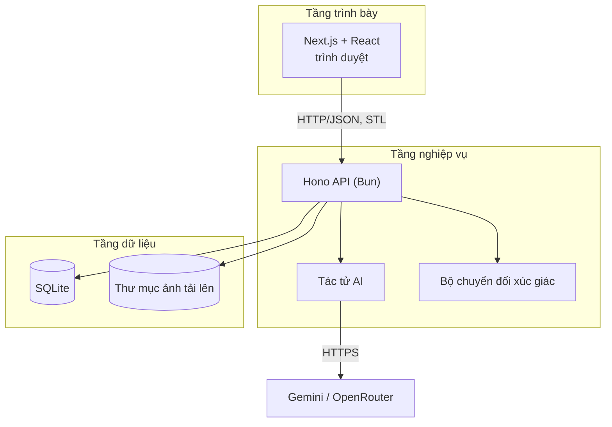
*Hình 2.1. Kiến trúc client–server ba tầng áp dụng trong đề tài*

## 2.3 Các công nghệ và công cụ phát triển

**Bảng 2.2. Công nghệ sử dụng trong đề tài**

| Thành phần | Công nghệ | Vai trò và lý do lựa chọn |
|---|---|---|
| Ngôn ngữ | TypeScript 5 | Một ngôn ngữ cho cả giao diện và máy chủ; kiểu tĩnh giúp FloorModel nhất quán ở mọi nơi |
| Môi trường chạy | Bun 1.4.2 | Chạy TypeScript trực tiếp, có sẵn trình quản lý gói, `bun:sqlite`, `Bun.file`; khởi động nhanh |
| Giao diện | Next.js 16.3, React 19.2 | Định tuyến theo thư mục, SSR cho các trang thông tin, xây dựng bản `standalone` để đóng gói |
| Thành phần UI | Tailwind CSS 4, shadcn/ui, Radix UI | Bộ thành phần có sẵn, dễ tiếp cận (accessibility) |
| Xem 3D | three.js 0.185 (STLLoader, OrbitControls) | Hiển thị đúng tệp STL mà người dùng sẽ tải về |
| API | Hono 4.13 | Framework web nhỏ, nhanh, chạy tốt trên Bun |
| Kiểm tra dữ liệu | Zod 4.4 | Định nghĩa FloorModel một lần, vừa sinh kiểu TypeScript vừa kiểm tra lúc chạy |
| Cơ sở dữ liệu | SQLite (`bun:sqlite`), Drizzle ORM 0.45, drizzle-kit | Không cần máy chủ CSDL riêng; ORM có kiểu, sinh migration tự động |
| Mô hình AI | Google Gemini API, OpenRouter | Gemini có gói miễn phí; OpenRouter cho phép so sánh nhiều mô hình qua một API |
| Xác thực | NextAuth (Auth.js) 5 + Google OAuth | Đăng nhập tùy chọn trên giao diện |
| Đóng gói | Docker | Hai image riêng cho API và web |

## 2.4 Các hệ thống tương tự

**Sản xuất thủ công truyền thống.** Bản đồ xúc giác thường được làm bằng giấy nổi vi nang (swell/microcapsule paper), máy in nổi chữ braille (embosser) hoặc gia công khắc CNC. Chuyên gia phải vẽ lại bản đồ bằng phần mềm đồ họa, đơn giản hóa theo tiêu chuẩn, rồi mới sản xuất.

**TMAP – Tactile Map Automated Production** (Smith-Kettlewell Eye Research Institute) [9]: tự động tạo bản đồ đường phố xúc giác từ dữ liệu bản đồ số để in bằng máy in nổi. Hệ thống tập trung vào bản đồ ngoài trời và không xử lý sơ đồ trong nhà.

**Touch Mapper** [10]: dịch vụ web tạo bản đồ xúc giác in 3D từ dữ liệu OpenStreetMap theo địa chỉ người dùng nhập. Touch Mapper chứng minh in 3D là phương án khả thi, nhưng phụ thuộc dữ liệu OSM có sẵn và chủ yếu phục vụ khu vực ngoài trời.

**Nghiên cứu nhận dạng sơ đồ mặt bằng.** Các công trình như Raster-to-Vector [11], Deep Floor Plan Recognition [12] và bộ dữ liệu CubiCasa5K [13] dùng mạng nơ-ron tích chập được huấn luyện chuyên biệt để tách tường, cửa, phòng từ ảnh sơ đồ. Các phương pháp này cho độ chính xác cao trên miền dữ liệu đã huấn luyện, nhưng cần dữ liệu gán nhãn, khó tổng quát sang kiểu bản vẽ khác, và chỉ dừng ở bước nhận dạng chứ không tạo bản đồ xúc giác.

**Bảng 2.4. So sánh các hệ thống tương tự**

| Tiêu chí | Thủ công | TMAP | Touch Mapper | Nhận dạng sơ đồ (CNN) | **Đề tài** |
|---|---|---|---|---|---|
| Trong nhà | Có | Không | Hạn chế | Có | **Có** |
| Đầu vào | Bản vẽ | Dữ liệu bản đồ | OSM | Ảnh sơ đồ | **Ảnh sơ đồ** |
| Cần huấn luyện mô hình | – | – | – | Có | **Không** |
| Con người kiểm tra | Có | Hạn chế | Không | Không | **Có, theo độ tin cậy** |
| Xuất in 3D | Tùy | Không (in nổi) | Có | Không | **Có (STL)** |
| Kiểm tra tiêu chuẩn tự động | Không | Có một phần | Có một phần | Không | **Có, có cảnh báo** |
| Thời gian tạo | Vài tuần | Vài phút | Vài phút | – | **Vài phút** |

## 2.5 Nhận xét và định hướng giải pháp

Từ phân tích trên, có thể rút ra các nhận xét:

1. Các hệ thống tự động hiện có chủ yếu phục vụ **bản đồ ngoài trời** dựa trên dữ liệu bản đồ số; bản đồ **trong nhà** vẫn chủ yếu làm thủ công.
2. Các phương pháp nhận dạng sơ đồ bằng mạng chuyên biệt **cần dữ liệu huấn luyện** và dừng ở bước nhận dạng. MLLM đa dụng có thể đọc nhiều kiểu bản vẽ mà không cần huấn luyện, nhưng **không ổn định** và có thể sai.
3. Vì người khiếm thị không thể tự kiểm tra bản đồ bằng mắt, một bản đồ sai là rủi ro thực sự. Do đó **không thể giao toàn bộ quy trình cho AI**.

Định hướng giải pháp của đề tài:

- Dùng **MLLM có sẵn qua API** cho bước khó nhất là đọc bản vẽ, cho phép chọn mô hình theo chất lượng và chi phí.
- Bắt buộc **con người kiểm tra** với sự hỗ trợ của độ tin cậy và tác tử chỉnh sửa bằng ngôn ngữ tự nhiên.
- Đặt toàn bộ **tiêu chuẩn xúc giác vào mã tất định**, có thể kiểm thử riêng, và cảnh báo mọi vi phạm.
- Giữ kiến trúc **đơn giản**: một định dạng dữ liệu chung, một bảng CSDL, một lần gọi AI cho mỗi thao tác.

---

# CHƯƠNG 3. PHÂN TÍCH VÀ THIẾT KẾ HỆ THỐNG

## 3.1 Phân tích yêu cầu hệ thống

### 3.1.1 Các tác nhân

| Tác nhân | Mô tả |
|---|---|
| Người tạo bản đồ | Nhân viên hỗ trợ tiếp cận; tải ảnh lên, kiểm tra, chỉnh sửa và tải tệp in |
| Người khách | Người truy cập trang web để tìm hiểu (xem trang thông tin, thư viện mẫu) |
| Dịch vụ mô hình AI | Hệ thống bên ngoài (Gemini API hoặc OpenRouter) mà tác tử gọi đến |
| Google OAuth | Hệ thống bên ngoài cung cấp đăng nhập |

Người đọc bản đồ (người khiếm thị) không tương tác trực tiếp với phần mềm mà dùng sản phẩm in ra.

### 3.1.2 Yêu cầu chức năng

**Bảng 3.1. Yêu cầu chức năng**

| Mã | Yêu cầu | Mô tả |
|---|---|---|
| FR01 | Tải ảnh sơ đồ | Nhận ảnh PNG/JPG/WebP ≤ 10 MB, tên dự án tùy chọn, chọn mô hình AI trong danh sách cho phép |
| FR02 | Đọc sơ đồ tự động | Tác tử đọc chạy nền, trích xuất tường, cửa, phòng, ký hiệu kèm độ tin cậy; từ chối ảnh không phải sơ đồ 2D |
| FR03 | Theo dõi trạng thái | Hiển thị trạng thái đã tải lên / đang đọc / sẵn sàng / thất bại; tự cập nhật |
| FR04 | Đọc lại | Cho phép chạy lại tác tử đọc khi thất bại |
| FR05 | Dùng dữ liệu mẫu | Tạo dự án "Văn phòng mẫu" không cần khóa AI |
| FR06 | Quản lý dự án | Liệt kê, mở, xóa dự án |
| FR07 | Hiển thị để kiểm tra | Vẽ FloorModel đè lên ảnh gốc; tô màu phần tử có độ tin cậy < 0,7; đếm số phần tử cần kiểm tra; nút "xem tiếp" |
| FR08 | Chỉnh sửa thủ công | Chọn, kéo điểm, thêm tường/cửa/ký hiệu, đổi tên phòng, đổi độ rộng cửa, xóa, đánh dấu đã kiểm tra |
| FR09 | Lưu chỉnh sửa | Lưu FloorModel sau khi kiểm tra hợp lệ |
| FR10 | Chỉnh sửa bằng AI | Nhận câu lệnh ngôn ngữ tự nhiên, tác tử chỉnh sửa áp dụng thay đổi |
| FR11 | Chuyển đổi xúc giác | Sinh tấm bản đồ theo tiêu chuẩn, sinh chú giải chữ nổi, liệt kê cảnh báo |
| FR12 | Xem trước 3D | Hiển thị đúng tệp STL sẽ tải về, xoay/phóng to được |
| FR13 | Xuất tệp | Tải về `map.stl` và `legend.stl` |
| FR14 | Trang thông tin | Nhu cầu, chức năng, cách hoạt động, hướng dẫn chọn ảnh, thư viện mẫu |
| FR15 | Đăng nhập | Đăng nhập bằng Google (tùy chọn, khi đã cấu hình) |

### 3.1.3 Yêu cầu phi chức năng

**Bảng 3.2. Yêu cầu phi chức năng**

| Mã | Nhóm | Yêu cầu |
|---|---|---|
| NFR01 | An toàn sản phẩm | Mọi kích thước vật lý do mã tất định quyết định; mô hình AI không thể thay đổi tiêu chuẩn |
| NFR02 | Tuân thủ tiêu chuẩn | Khe cửa ≥ 5 mm, chấm braille cao 0,7 mm, ký hiệu cách nhau ≥ 3 mm khoảng trống |
| NFR03 | Minh bạch | Mọi phần tử AI không chắc chắn đều được đánh dấu; mọi vi phạm đều được cảnh báo trước khi xuất |
| NFR04 | Kiểm soát chi phí | Chỉ dùng mô hình trong danh sách do máy chủ quy định; hiển thị chi phí ước tính |
| NFR05 | Độ bền | Tự thử lại khi dịch vụ AI quá tải (429/500/503); dự án đang đọc khi máy chủ khởi động lại được đánh dấu thất bại để thử lại |
| NFR06 | Hiệu năng | Chuyển đổi xúc giác dưới 1 giây; đọc sơ đồ thường 1–3 phút |
| NFR07 | Dễ cài đặt | Chạy cục bộ bằng hai lệnh; đóng gói Docker |
| NFR08 | Dễ bảo trì | Một định dạng dữ liệu chung; mã ngắn, rõ ràng, có kiểu |
| NFR09 | Bảo mật | Khóa API chỉ nằm ở máy chủ; giới hạn loại và kích thước tệp; tên tệp tải về được làm sạch |
| NFR10 | Khả năng tiếp cận | Giao diện tiếng Việt; trình xem 3D có nhãn cho trình đọc màn hình |

## 3.2 Mô hình nghiệp vụ

### 3.2.1 Biểu đồ use case

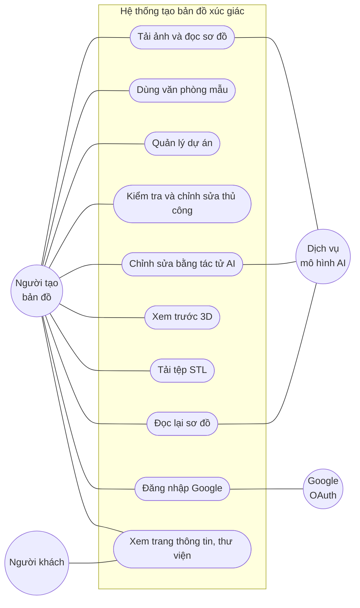
*Hình 3.1. Biểu đồ use case tổng quát*

### 3.2.2 Đặc tả use case

**Bảng 3.3. Đặc tả use case "Tải ảnh lên và đọc sơ đồ"**

| Mục | Nội dung |
|---|---|
| Tác nhân | Người tạo bản đồ, Dịch vụ mô hình AI |
| Tiền điều kiện | Máy chủ đã cấu hình khóa API |
| Luồng chính | 1. Người dùng chọn ảnh, nhập tên (tùy chọn), chọn mô hình. 2. Hệ thống kiểm tra loại tệp, dung lượng, mô hình. 3. Hệ thống lưu ảnh, tạo dự án trạng thái "đã tải lên", trả về ngay. 4. Giao diện chuyển sang trang dự án và hỏi trạng thái mỗi 2 giây. 5. Tác tử đọc gửi ảnh và chỉ dẫn đến mô hình AI. 6. Hệ thống chuẩn hóa kết quả thành FloorModel, lưu, chuyển trạng thái "sẵn sàng". 7. Giao diện hiển thị trình chỉnh sửa. |
| Luồng thay thế | 2a. Tệp sai loại, quá 10 MB hoặc mô hình không được phép: báo lỗi, dừng. 5a. Dịch vụ AI trả 429/500/503: chờ 5 s, 15 s, 30 s rồi thử lại. 6a. Mô hình đánh giá ảnh là "poor" hoặc không trả JSON: trạng thái "thất bại" kèm thông báo; người dùng có thể chọn "Thử lại". |
| Hậu điều kiện | Dự án có FloorModel ở trạng thái "sẵn sàng" hoặc ở trạng thái "thất bại" kèm lý do |

**Bảng 3.4. Đặc tả use case "Chỉnh sửa bằng tác tử AI"**

| Mục | Nội dung |
|---|---|
| Tác nhân | Người tạo bản đồ, Dịch vụ mô hình AI |
| Tiền điều kiện | Dự án ở trạng thái "sẵn sàng" |
| Luồng chính | 1. Người dùng nhập câu lệnh, ví dụ "thêm một cửa giữa sảnh và hành lang". 2. Nếu có thay đổi chưa lưu, giao diện lưu trước. 3. Tác tử chỉnh sửa gửi FloorModel hiện tại, ảnh gốc và câu lệnh đến mô hình. 4. Hệ thống chuẩn hóa kết quả, lưu và trả về. 5. Giao diện cập nhật bản vẽ. |
| Luồng thay thế | 1a. Câu lệnh rỗng: báo lỗi. 3a. Mô hình lỗi: trả mã 502 kèm thông báo, FloorModel giữ nguyên. |
| Hậu điều kiện | FloorModel được cập nhật; phần tử thêm hoặc sửa theo yêu cầu có độ tin cậy 1 |

### 3.2.3 Biểu đồ hoạt động

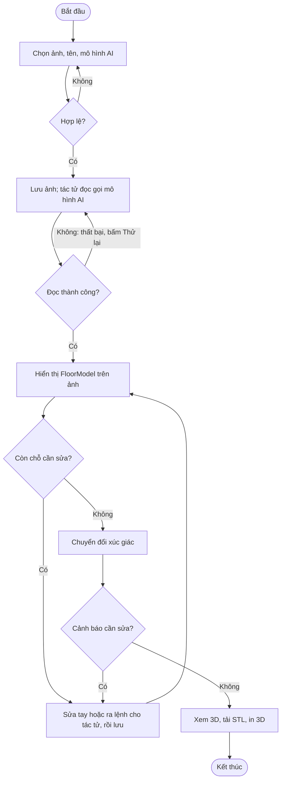
*Hình 3.2. Biểu đồ hoạt động: tạo bản đồ từ ảnh sơ đồ*

### 3.2.4 Biểu đồ trạng thái của dự án

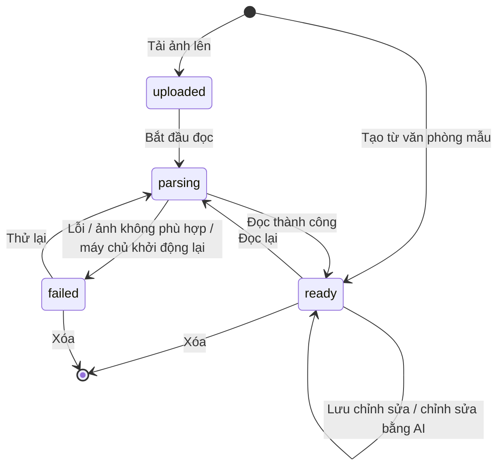
*Hình 3.3. Biểu đồ trạng thái của một dự án*

## 3.3 Thiết kế kiến trúc hệ thống

### 3.3.1 Kiến trúc tổng thể

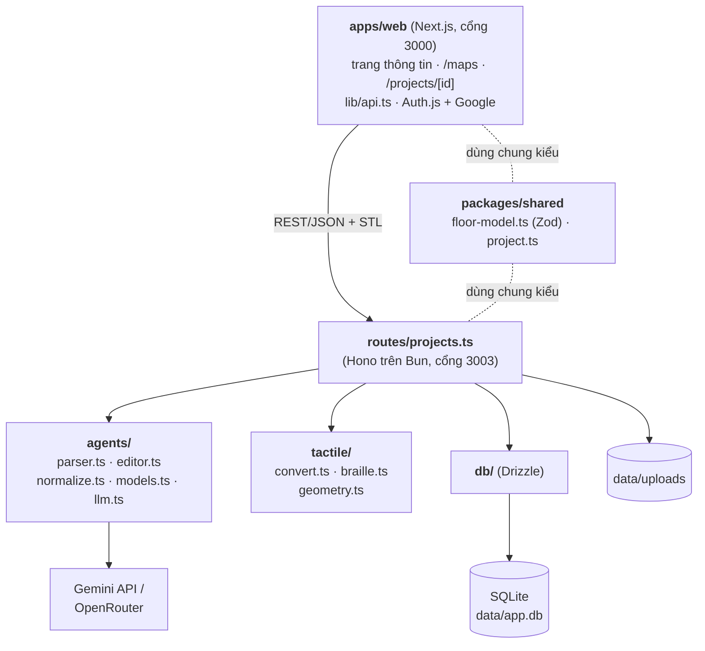
*Hình 3.4. Kiến trúc tổng thể của hệ thống*

Hệ thống gồm ba gói trong một monorepo:

- **`packages/shared`**: định nghĩa FloorModel bằng Zod và các kiểu dùng chung (`Project`, `TactileSummary`, `ModelOptions`). Đây là "hợp đồng" duy nhất giữa các thành phần. Mọi thay đổi định dạng đều bắt đầu ở đây.
- **`apps/api`**: máy chủ Hono gồm bốn mô-đun: `routes` (endpoint), `agents` (gọi AI), `tactile` (chuyển đổi tất định), `db` (lưu trữ).
- **`apps/web`**: ứng dụng Next.js. Mọi lời gọi đến máy chủ tập trung trong `lib/api.ts`; mọi chuỗi giao diện tập trung trong `data/`.

### 3.3.2 Thiết kế API

**Bảng 3.5. Danh sách endpoint của API**

| Phương thức | Đường dẫn | Chức năng | Mã trả về |
|---|---|---|---|
| GET | `/` | Kiểm tra sức khỏe, cho biết nhà cung cấp và mô hình mặc định | 200 |
| GET | `/models` | Danh sách mô hình được phép kèm chi phí ước tính | 200 |
| GET | `/projects` | Danh sách dự án, mới nhất trước | 200 |
| POST | `/projects` | Tải ảnh (multipart: `file`, `name`, `model`), bắt đầu đọc nền | 201, 400 |
| POST | `/projects/sample` | Tạo dự án từ văn phòng mẫu | 201 |
| GET | `/projects/:id` | Thông tin một dự án | 200, 404 |
| DELETE | `/projects/:id` | Xóa dự án và ảnh | 204, 404 |
| GET | `/projects/:id/image` | Ảnh gốc | 200, 404 |
| POST | `/projects/:id/parse` | Đọc lại sơ đồ | 202, 404, 409 |
| PUT | `/projects/:id/model` | Lưu FloorModel (kiểm tra bằng Zod) | 200, 400, 404 |
| POST | `/projects/:id/edit` | Chỉnh sửa bằng tác tử AI (`{instruction}`) | 200, 400, 404, 502 |
| GET | `/projects/:id/tactile` | Chú giải, cảnh báo, tỉ lệ mm/px | 200, 404 |
| GET | `/projects/:id/map.stl` | Tấm bản đồ (thêm `?download=1` để tải) | 200, 404 |
| GET | `/projects/:id/legend.stl` | Tấm chú giải | 200, 404 |

Hai quyết định thiết kế đáng chú ý:

1. **Đọc sơ đồ chạy nền + hỏi lại (polling).** Một lần gọi MLLM với ảnh có thể mất từ vài chục giây đến vài phút. Thay vì giữ kết nối HTTP mở, `POST /projects` trả về ngay với trạng thái `uploaded`; hàm `runParse` chạy nền và cập nhật CSDL; giao diện gọi `GET /projects/:id` mỗi 2 giây. Cách này đơn giản hơn WebSocket mà vẫn đủ dùng.
2. **STL được sinh khi được yêu cầu, không lưu.** Bộ chuyển đổi chạy trong vài mili giây, nên tệp STL được tính lại từ FloorModel mỗi lần tải. Nhờ vậy không bao giờ có tệp STL cũ lệch với FloorModel.

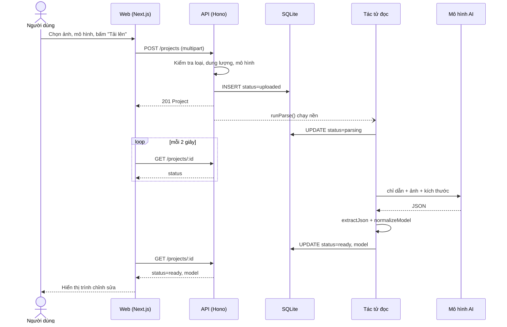
*Hình 3.5. Biểu đồ tuần tự: tải ảnh lên và đọc sơ đồ*

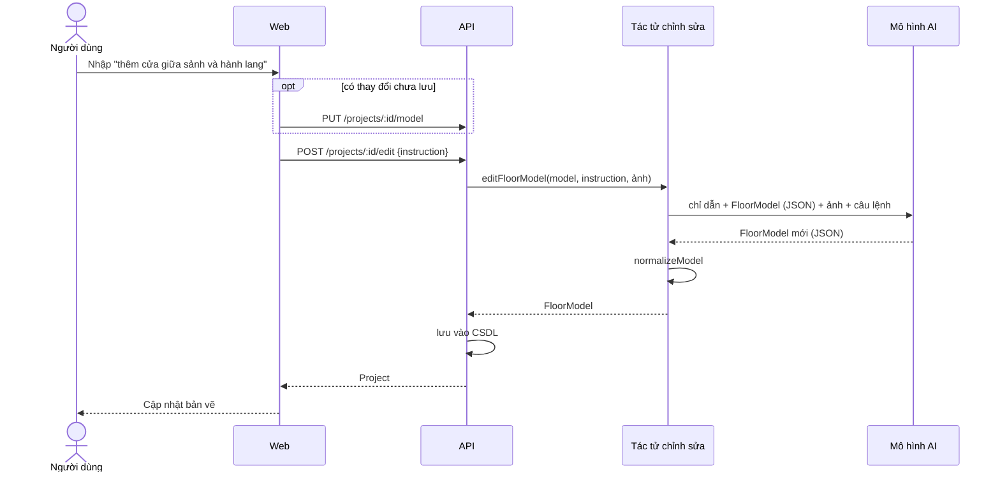
*Hình 3.6. Biểu đồ tuần tự: chỉnh sửa bằng tác tử AI*

### 3.3.3 Thiết kế tác tử AI

**Lớp gọi mô hình (`llm.ts`)** cung cấp một hàm duy nhất `askModel({agent, model, instruction, text, image})` và ẩn đi sự khác biệt giữa hai nhà cung cấp:

- Gemini: gửi `systemInstruction`, ảnh dạng `inline_data` base64, `responseMimeType: application/json`, `temperature: 0.1`.
- OpenRouter: định dạng tương thích OpenAI, ảnh dạng `data:` URL, `max_tokens: 32768`, `temperature: 0.1`.

Hàm tự thử lại tối đa ba lần (sau 5, 15, 30 giây) với mã lỗi 429, 500, 503, và giới hạn mỗi lời gọi trong 5 phút. Hàm `extractJson` lấy đoạn từ dấu `{` đầu tiên đến dấu `}` cuối cùng, vì mô hình đôi khi bọc JSON trong lời giải thích hoặc khối markdown.

**Tác tử đọc (`parser.ts`)** dùng một chỉ dẫn hệ thống với các ý chính:

1. Đánh giá ảnh trước: `suitability` là `good`, `usable` hoặc `poor` (ảnh chụp, phối cảnh 3D, bản vẽ không đọc được).
2. Làm theo thứ tự: tường (chu vi trước, rồi từng phòng) → cửa → phòng → ký hiệu.
3. Quy tắc: tọa độ theo pixel của ảnh, gốc ở góc trên trái; chỉ vẽ cửa khi có bằng chứng (cung mở cửa, cánh trượt, khe hở giữa hai đầu tường thẳng hàng); không coi cửa sổ là cửa; bỏ qua đường kích thước, nội thất, khung tên.
4. Độ tin cậy phải trung thực và không được đồng loạt bằng nhau.
5. Trả về đúng một mẫu JSON.

Chỉ dẫn nhấn mạnh hậu quả với người dùng cuối: *"mọi thứ bạn bỏ sót sẽ vắng mặt trong thế giới của họ và mọi thứ bạn bịa ra sẽ đánh lừa họ"*.

**Tác tử chỉnh sửa (`editor.ts`)** nhận FloorModel hiện tại dạng JSON, ảnh gốc (nếu có) và câu lệnh. Chỉ dẫn yêu cầu chỉ thay đổi đúng phần được yêu cầu, giữ nguyên mọi phần tử khác, và gán độ tin cậy 1 cho phần tử được thêm hoặc sửa theo yêu cầu của người dùng.

**Bộ chuẩn hóa (`normalize.ts`)** là lớp phòng thủ giữa AI và phần còn lại của hệ thống:

- Chấp nhận điểm dạng `[x, y]` hoặc `{x, y}`.
- Mỗi phần tử sai cấu trúc bị **bỏ qua** chứ không làm hỏng cả kết quả.
- Độ tin cậy thiếu hoặc ngoài khoảng [0, 1] được đặt về 0,5.
- Tọa độ bị kẹp (clamp) vào trong kích thước ảnh.
- Tường có hai đầu trùng nhau bị loại.
- Gán lại mã định danh mới, duy nhất: `w-1`, `d-1`, `r-1`, `f-1`...
- Nếu `suitability = "poor"` thì báo lỗi bằng tiếng Việt.

**Danh sách mô hình được phép (`models.ts`)** nằm ở máy chủ. Máy chủ từ chối mọi mô hình ngoài danh sách, nên không ai có thể chạy một mô hình đắt tiền bằng cách sửa trang web.

### 3.3.4 Thiết kế bộ chuyển đổi xúc giác

Bộ chuyển đổi (`tactile/convert.ts`) là mã tất định, không gọi AI. Đầu vào là FloorModel (đơn vị pixel), đầu ra là danh sách tam giác (đơn vị mm) và một bản tóm tắt gồm chú giải, cảnh báo và tỉ lệ.

**Bảng 3.6. Các hằng số xúc giác trong bộ chuyển đổi**

| Hằng số | Giá trị | Ý nghĩa |
|---|---|---|
| `PLATE` | 200 × 200 mm, đế dày 3 mm, lề 10 mm | Kích thước tấm, vừa bàn in phổ thông |
| `WALL` | rộng 2 mm, cao 1,0 mm | Tường là đường nổi |
| `SYMBOL` | cỡ 6 mm, cao 1,5 mm | Ký hiệu cao hơn tường để phân biệt |
| `MIN_DOOR_GAP_MM` | 5 mm | Khe cửa tối thiểu để ngón tay cảm nhận |
| `MIN_SYMBOL_SPACING_MM` | 9 mm (tâm–tâm) | 6 mm ký hiệu + 3 mm khoảng trống |
| `BRAILLE_MM` | Xem Bảng 2.3 | Kích thước chữ nổi theo ADA §703 |

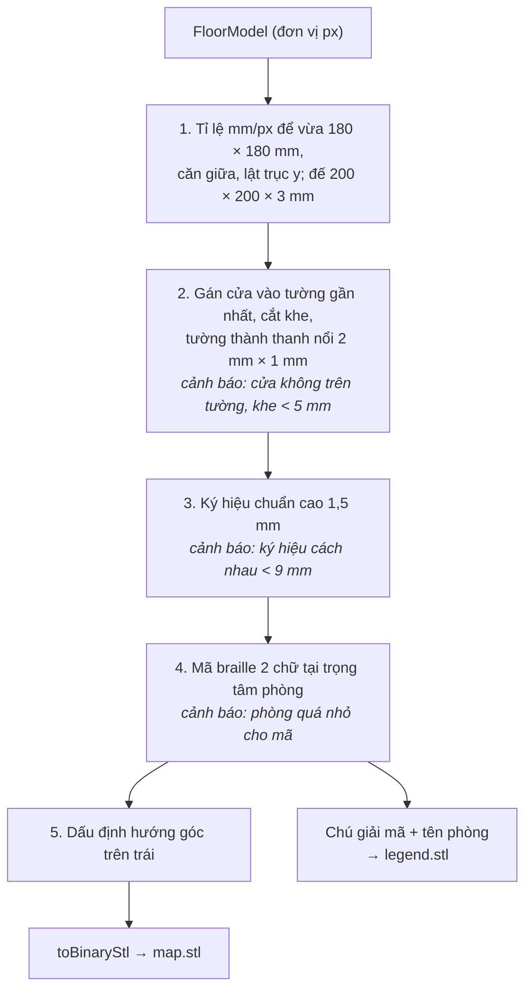
*Hình 3.7. Luồng xử lý của bộ chuyển đổi xúc giác*

Một số thuật toán chính:

- **Gán cửa vào tường:** với mỗi cửa, chiếu điểm tâm cửa lên từng đoạn tường, chọn tường có khoảng cách nhỏ nhất. Nếu khoảng cách lớn hơn `max(width/2, 10)` pixel, cửa bị coi là không nằm trên tường nào và sinh cảnh báo.
- **Cắt khe tường:** các khoảng `[along − width/2, along + width/2]` trên mỗi tường được sắp xếp, phần còn lại là các đoạn tường đặc; đoạn ngắn hơn 1 pixel bị bỏ.
- **Mã chữ nổi cho phòng:** mã gồm 2 chữ cái, ưu tiên chữ đầu tiên của tên phòng ghép với các chữ tiếp theo ("Lobby" → "lo", "Lab" → "la"), bảo đảm duy nhất. Mã được đặt tại trọng tâm đa giác phòng (công thức trọng tâm theo diện tích có dấu).
- **Hình học:** mọi khối là lăng trụ đáy lồi (`prism`), được sắp ngược chiều kim đồng hồ để pháp tuyến hướng ra ngoài. Tường và bậc thang là thanh (`bar`) kéo dài thêm nửa bề rộng ở hai đầu để các góc khép kín. Chấm braille là chỏm cầu (`dome`) với bán kính cầu R = (r² + h²) / 2h, chia 4 vòng × 12 phân đoạn.

## 3.4 Thiết kế cơ sở dữ liệu

### 3.4.1 Mô hình dữ liệu

Hệ thống chỉ có **một bảng** `projects`. FloorModel được lưu thành một cột JSON thay vì tách thành các bảng `walls`, `doors`, `rooms`, `features`. Lý do:

- FloorModel luôn được đọc và ghi **trọn vẹn** (giao diện lưu cả mô hình, tác tử trả về cả mô hình); không có truy vấn nào cần lọc theo từng bức tường.
- Cấu trúc bên trong được kiểm tra bằng Zod ở tầng ứng dụng, là cùng một định nghĩa với giao diện và tác tử.
- Giữ cho lược đồ CSDL đơn giản, migration ít.

Ảnh tải lên được lưu ở thư mục `data/uploads/` với tên `<id>.<đuôi>`; CSDL chỉ lưu đường dẫn. SQLite chạy ở chế độ WAL để đọc và ghi đồng thời tốt hơn.

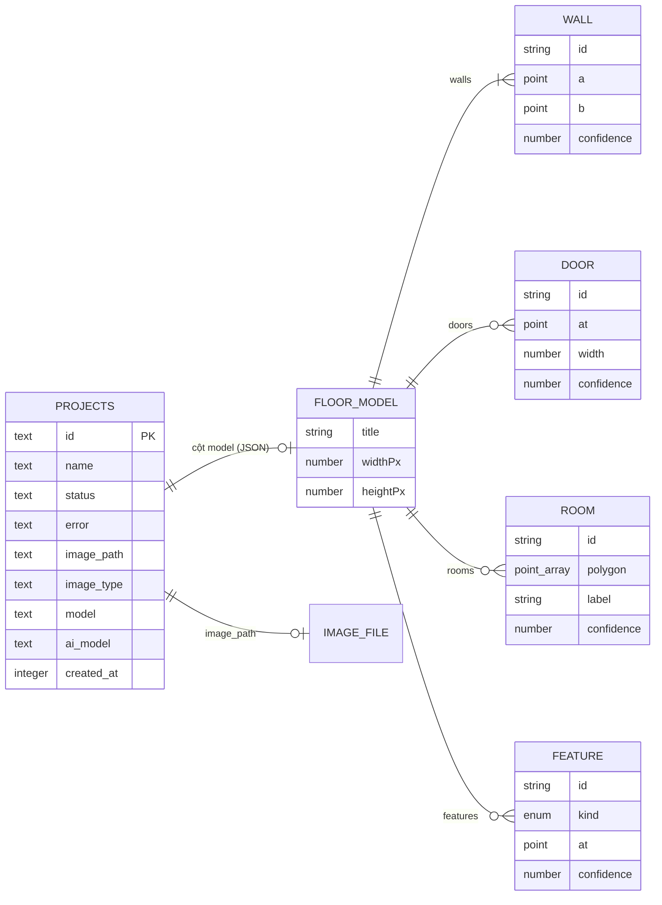
*Hình 3.8. Sơ đồ thực thể – liên kết (ERD). Các thực thể dưới PROJECTS là cấu trúc JSON lồng trong cột `model`, không phải bảng riêng.*

### 3.4.2 Cấu trúc bảng

**Bảng 3.7. Cấu trúc bảng `projects`**

| Cột | Kiểu | Ràng buộc | Mô tả |
|---|---|---|---|
| `id` | text | PK | UUID ngẫu nhiên |
| `name` | text | NOT NULL | Tên dự án (mặc định là tên tệp) |
| `status` | text | NOT NULL | `uploaded`, `parsing`, `ready`, `failed` |
| `error` | text | | Lý do thất bại |
| `image_path` | text | | Đường dẫn ảnh; NULL với dự án mẫu |
| `image_type` | text | | `image/png`, `image/jpeg`, `image/webp` |
| `model` | text (JSON) | | FloorModel |
| `ai_model` | text | | Mô hình AI đã đọc hoặc sửa gần nhất (thêm ở migration 0001) |
| `created_at` | integer (ms) | NOT NULL | Thời điểm tạo |

Migration được sinh bằng `drizzle-kit generate` (`0000_projects.sql`, `0001_ai_model.sql`) và được áp dụng tự động khi API khởi động.

**Bảng 3.8. Cấu trúc FloorModel** (đơn vị pixel của ảnh, gốc ở góc trên trái, trục y hướng xuống)

| Trường | Kiểu | Ràng buộc |
|---|---|---|
| `title` | string \| null | ≤ 100 ký tự |
| `widthPx`, `heightPx` | number | > 0 |
| `walls[]` | `{id, a: Point, b: Point, confidence}` | |
| `doors[]` | `{id, at: Point, width, confidence}` | width > 0 |
| `rooms[]` | `{id, polygon: Point[], label, confidence}` | polygon ≥ 3 điểm, label ≤ 100 ký tự hoặc null |
| `features[]` | `{id, kind, at: Point, confidence}` | kind ∈ {stairs, elevator, entrance, restroom} |
| `confidence` | number | 0 ≤ c ≤ 1; dưới `REVIEW_THRESHOLD = 0,7` thì cần kiểm tra |

## 3.5 Thiết kế giao diện

### 3.5.1 Nguyên tắc thiết kế

- **Một đường đi rõ ràng:** trang chủ → "Bắt đầu tạo bản đồ" → tải lên → kiểm tra (bước 1) → xem 3D và xuất (bước 2).
- **Trung thực về AI:** luôn hiển thị mô hình nào đã đọc sơ đồ; phần tử AI không chắc chắn được tô màu hổ phách; số phần tử cần kiểm tra luôn hiển thị.
- **Xem đúng thứ sẽ in:** trình xem 3D tải chính tệp STL mà nút "Tải bản đồ" trả về.
- **Toàn bộ chuỗi giao diện bằng tiếng Việt**, tập trung trong `data/content.ts` và `data/site-pages.ts`.

### 3.5.2 Sơ đồ điều hướng

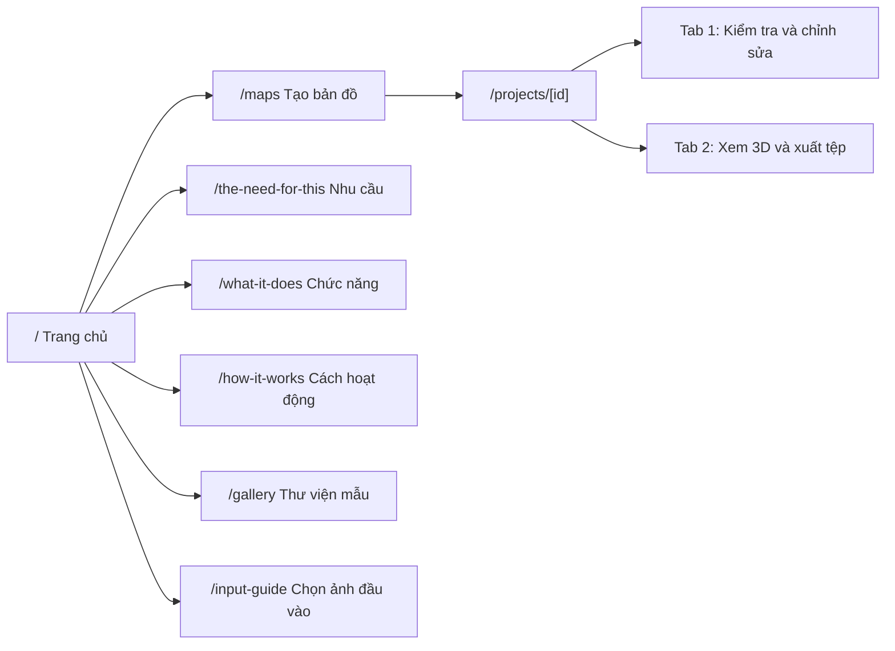
*Hình 3.9. Sơ đồ điều hướng giữa các trang*

### 3.5.3 Các màn hình chính

**Trang tạo bản đồ (`/maps`).** Thẻ tải lên gồm: chọn tệp (PNG, JPG, WebP), tên (không bắt buộc), danh sách "Mô hình AI" kèm chi phí ước tính mỗi lần chạy (chỉ hiện khi dùng OpenRouter), nút "Tải lên và đọc sơ đồ" và nút "Dùng thử văn phòng mẫu (không cần khóa AI)". Bên dưới là danh sách "Bản đồ của bạn" với nút Mở và Xóa.

**Trang dự án khi đang đọc.** Biểu tượng đang tải, dòng "Tác tử phân tích đang đọc sơ đồ của bạn" và "Thường mất từ 1 đến 3 phút. Trang sẽ tự cập nhật." Khi thất bại: thông báo lỗi và nút "Thử lại".

**Tab 1 – Kiểm tra và chỉnh sửa.**

```
┌──────────────────────────────────────────────────┬──────────────────────┐
│ [Chọn/di chuyển][Thêm tường][Thêm cửa]           │ Mô hình AI           │
│ [Cầu thang][Thang máy][Lối vào][Nhà vệ sinh]     │ google/gemini-...    │
│ Gợi ý: Nhấp vào một phần tử để chọn...           ├──────────────────────┤
│ ┌──────────────────────────────────────────────┐ │ [Lưu thay đổi]       │
│ │                                              │ │ Có thay đổi chưa lưu │
│ │   ẢNH SƠ ĐỒ GỐC                              │ ├──────────────────────┤
│ │   + lớp SVG: tường, cửa, phòng, ký hiệu      │ │ 4 phần tử cần kiểm   │
│ │   (hổ phách = độ tin cậy < 0,7;              │ │ tra     [Xem tiếp]   │
│ │    chấm tròn = điểm kéo được)                │ ├──────────────────────┤
│ │                                              │ │ Phần tử đang chọn:   │
│ │                                              │ │ loại, độ tin cậy,    │
│ │                                              │ │ tên phòng / độ rộng  │
│ └──────────────────────────────────────────────┘ │ [Đã kiểm tra][Xóa]   │
│                                                  ├──────────────────────┤
│                                                  │ Chỉnh sửa bằng AI    │
│                                                  │ [ô nhập] [Áp dụng]   │
└──────────────────────────────────────────────────┴──────────────────────┘
```
*Hình 3.10. Bố cục màn hình kiểm tra và chỉnh sửa*

Trình chỉnh sửa vẽ bằng SVG đè lên ảnh, dùng chung hệ tọa độ pixel với FloorModel nên không cần quy đổi. Thay đổi được giữ ở trạng thái nháp trong trình duyệt cho đến khi bấm "Lưu thay đổi". Phím Delete xóa phần tử đang chọn, Esc hủy thao tác. Các phép biến đổi FloorModel (`movePoint`, `updateElement`, `removeElement`, `newId`) là hàm thuần trong `lib/floor-edit.ts`, luôn trả về đối tượng mới.

**Tab 2 – Xem 3D và xuất tệp.**

```
┌──────────────────────────────────────────┬──────────────────────────┐
│                                          │ [Tải bản đồ .stl]        │
│                                          │ [Tải chú giải .stl]      │
│     TRÌNH XEM 3D (three.js)              │ In nằm phẳng, đầu phun   │
│     tấm 200 × 200 mm                     │ 0,4 mm, không cần giá đỡ │
│     kéo để xoay, cuộn để phóng to        ├──────────────────────────┤
│                                          │ Kiểm tra: danh sách      │
│                                          │ cảnh báo                 │
│                                          ├──────────────────────────┤
│                                          │ Chú giải chữ nổi:        │
│                                          │ st  studio  /  la  lab   │
│                                          ├──────────────────────────┤
│                                          │ Ký hiệu: ba thanh ngang  │
│                                          │ = cầu thang, ...         │
└──────────────────────────────────────────┴──────────────────────────┘
```
*Hình 3.11. Bố cục màn hình xem 3D và xuất tệp*

Trình xem 3D dùng ánh sáng xiên thấp để các chi tiết nổi đổ bóng rõ, xoay mô hình từ trục z hướng lên (STL) sang trục y hướng lên (three.js), và tải lại mỗi khi FloorModel được lưu.

> [Chèn ảnh chụp màn hình thực tế của các trang `/`, `/maps`, tab 1 và tab 2 khi hoàn thiện báo cáo.]

---

# CHƯƠNG 4. TRIỂN KHAI HỆ THỐNG VÀ THỰC NGHIỆM

## 4.1 Môi trường phát triển

**Bảng 4.1. Môi trường và phiên bản công cụ**

| Hạng mục | Phiên bản |
|---|---|
| Hệ điều hành phát triển | Windows 11 Home |
| Môi trường chạy | Bun 1.4.2 (phát triển, API); Node.js 22 (image web) |
| Ngôn ngữ | TypeScript 5 |
| Giao diện | Next.js 16.3.1, React 19.2.8, Tailwind CSS 4, shadcn/ui |
| Xem 3D | three.js 0.185 |
| API | Hono 4.13.3, image-size 2.0 |
| Dữ liệu | SQLite (`bun:sqlite`), Drizzle ORM 0.45.2, drizzle-kit 0.31 |
| Kiểm tra dữ liệu | Zod 4.4.3 |
| Xác thực | next-auth 5 (beta) với Google |
| Mô hình AI | Gemini API (mặc định `gemini-3.7-flash`), OpenRouter |
| Đóng gói | Docker (`oven/bun:1.4.2`, `node:22-bookworm-slim`) |
| Quản lý mã nguồn | Git |
| Công cụ khác | VS Code, ESLint, trình cắt lớp in 3D (Cura / PrusaSlicer / Bambu Studio) |

## 4.2 Cài đặt và triển khai hệ thống

### 4.2.1 Cài đặt cục bộ

```bash
bun run setup   # bun install, tạo apps/api/.env và apps/web/.env.local từ tệp mẫu
bun run dev     # chạy song song web (cổng 3000) và API (cổng 3003)
```

Khi API khởi động, các bước sau diễn ra tự động: tạo thư mục `data/`, mở SQLite ở chế độ WAL, áp dụng migration, chuyển mọi dự án đang `parsing` sang `failed` (vì lần đọc dở dang sẽ không bao giờ hoàn tất), rồi lắng nghe ở cổng 3003. Có thể dùng thử toàn bộ quy trình với nút "Dùng thử văn phòng mẫu" mà không cần khóa AI.

**Bảng 4.2. Biến môi trường**

| Biến | Tệp | Ý nghĩa |
|---|---|---|
| `GEMINI_API_KEY` | `apps/api/.env` | Khóa Google AI Studio |
| `MODEL_PROVIDER` | `apps/api/.env` | `gemini` (mặc định) hoặc `openrouter` |
| `OPENROUTER_API_KEY` | `apps/api/.env` | Khóa OpenRouter |
| `MODEL` | `apps/api/.env` | Mô hình mặc định (tùy chọn) |
| `DATABASE_PATH`, `UPLOADS_DIR` | `apps/api/.env` | Vị trí CSDL và ảnh |
| `PORT` | môi trường | Cổng API khi triển khai |
| `NEXT_PUBLIC_API_URL` | `apps/web/.env.local` | Địa chỉ API (được nhúng lúc build) |
| `AUTH_SECRET`, `AUTH_GOOGLE_ID`, `AUTH_GOOGLE_SECRET` | `apps/web/.env.local` | Đăng nhập Google (tùy chọn) |

API chỉ đọc `.env` khi khởi động, nên phải khởi động lại sau mỗi lần sửa. Endpoint `GET /` cho biết API đang dùng nhà cung cấp và mô hình nào.

### 4.2.2 Một số điểm cài đặt đáng chú ý

**Định nghĩa FloorModel một lần, dùng ở ba nơi.** Lược đồ Zod trong `packages/shared` vừa sinh kiểu TypeScript cho giao diện và máy chủ, vừa được dùng để kiểm tra dữ liệu lúc chạy ở endpoint `PUT /projects/:id/model`. Giao diện không thể gửi lên một FloorModel sai cấu trúc mà máy chủ chấp nhận.

**Phòng thủ trước đầu ra của AI.** Đầu ra của mô hình đi qua ba lớp: `extractJson` (tách JSON), `normalizeModel` (bỏ phần tử hỏng, kẹp tọa độ, gán mã mới) và cuối cùng là bộ chuyển đổi (kiểm tra tiêu chuẩn). Không lớp nào tin rằng mô hình luôn trả về đúng.

**Xuất STL nhị phân không dùng thư viện.** Hàm `toBinaryStl` cấp phát một `ArrayBuffer` 84 + 50·n byte, ghi số tam giác, rồi với mỗi tam giác tính pháp tuyến bằng tích có hướng, chuẩn hóa và ghi 12 số thực 32 bit little-endian.

### 4.2.3 Triển khai bằng Docker

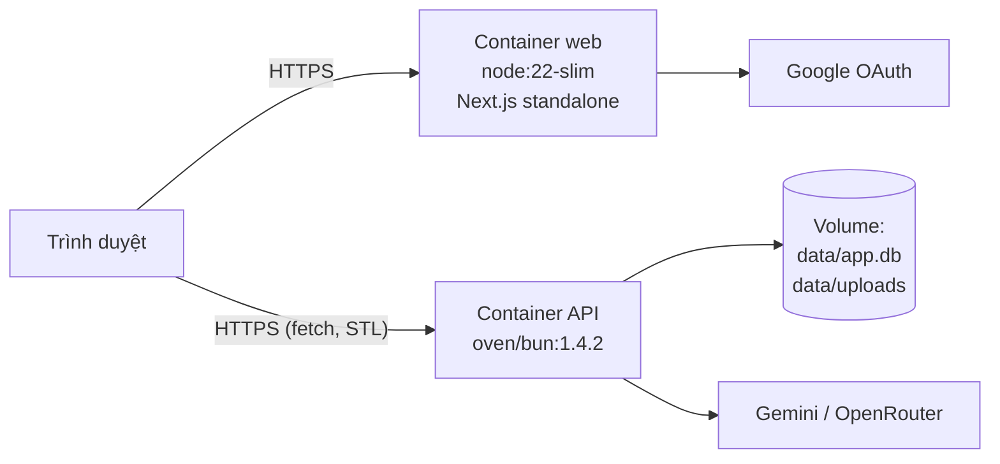
*Hình 4.1. Kiến trúc triển khai bằng Docker*

Hệ thống có hai Dockerfile, đều build từ thư mục gốc của monorepo:

- **`apps/api/Dockerfile`**: giai đoạn `deps` cài gói với `--linker=hoisted` để mọi gói nằm ở `node_modules` gốc; giai đoạn chạy chỉ chép `node_modules`, `packages/shared` và `apps/api`, chạy `bun src/index.ts`. Cổng lấy từ biến `PORT` do nền tảng cung cấp.
- **`apps/web/Dockerfile`**: build Next.js ở chế độ `standalone` với `NEXT_PUBLIC_API_URL` truyền qua `--build-arg` (vì biến này được nhúng vào mã lúc build), rồi chạy `node apps/web/server.js` trên image Node gọn nhẹ.

```bash
docker build -f apps/api/Dockerfile -t tactile-api .
docker build -f apps/web/Dockerfile --build-arg NEXT_PUBLIC_API_URL=https://<địa-chỉ-api> -t tactile-web .
```

Hai image có thể chạy trên bất kỳ nền tảng container nào (Render, Google Cloud Run...). Thư mục `data/` của API cần được gắn vào một ổ lưu trữ bền vững, nếu không CSDL và ảnh sẽ mất khi container khởi động lại.

> [Bổ sung địa chỉ bản triển khai demo và nền tảng đã dùng sau khi triển khai.]

## 4.3 Kiểm thử hệ thống

### 4.3.1 Chiến lược kiểm thử

| Mức | Phương pháp | Phạm vi |
|---|---|---|
| Kiểm tra tĩnh | `bun run typecheck` (tsc cho cả ba gói), `bun run lint` (ESLint) | Toàn bộ mã nguồn |
| Kiểm thử đơn vị | `bun test` cho các hàm thuần | `braille.ts`, `geometry.ts`, `convert.ts`, `normalize.ts`, `floor-edit.ts` |
| Kiểm thử tích hợp | Gọi API thật với CSDL tạm | Các endpoint trong Bảng 3.5 |
| Kiểm thử hệ thống | Chạy toàn bộ quy trình trên trình duyệt với sơ đồ thật | Các ca trong Bảng 4.3 |
| Kiểm thử chấp nhận | In 3D và cho người dùng đọc thử | Tấm bản đồ in ra |

Phần tất định (bộ chuyển đổi, chữ nổi, chuẩn hóa) là phần được ưu tiên kiểm thử đơn vị, vì đây là nơi bảo đảm an toàn cho người đọc bản đồ và có đầu ra xác định. Phần gọi AI được kiểm thử ở mức hệ thống bằng các lần chạy thật, vì đầu ra không xác định.

**Kết quả kiểm tra tĩnh (08/10/2026):** `bun run typecheck` chạy thành công cho cả `@capstone/shared`, `api` và `web` (mã thoát 0).

**Kiểm thử đơn vị:** chưa thực hiện tại thời điểm viết. Các ca kiểm thử dự kiến:

- `textToCells("ab1")` trả về `[[1], [1,2], [3,4,5,6], [1]]`; ký tự không hỗ trợ bị bỏ qua.
- `brailleSize` của một mã 2 ô có chiều rộng 6,1 + 2,3 = 8,4 mm.
- `toBinaryStl` của n tam giác có độ dài 84 + 50n byte và số tam giác đúng ở byte 80.
- `buildMapPlate` với một cửa có độ rộng quy đổi < 5 mm sinh đúng một cảnh báo khe cửa.
- `buildMapPlate` với hai ký hiệu cách nhau < 9 mm sinh cảnh báo khoảng cách.
- `normalizeModel` bỏ phần tử sai cấu trúc, kẹp tọa độ ra ngoài ảnh, ném lỗi khi `suitability = "poor"`.

> [Cập nhật kết quả sau khi viết xong bộ kiểm thử đơn vị.]

### 4.3.2 Ca kiểm thử chức năng

**Bảng 4.3. Ca kiểm thử chức năng**

| Mã | Ca kiểm thử | Kết quả mong đợi | Kết quả |
|---|---|---|---|
| TC01 | Tải ảnh PNG/JPG hợp lệ với khóa API đúng | Dự án chuyển uploaded → parsing → ready, có FloorModel | Đạt (12 lần đọc thành công, xem 4.4) |
| TC02 | Tải ảnh với khóa OpenRouter không hợp lệ | Trạng thái failed, thông báo lỗi 401 hiển thị | Đạt (1 lần ghi nhận lỗi "401: User not found") |
| TC03 | Tải tệp không phải ảnh, hoặc ảnh > 10 MB | Lỗi 400, thông báo tiếng Việt | [Chưa chạy] |
| TC04 | Gửi tên mô hình ngoài danh sách | Lỗi 400 "Mô hình không được phép" | [Chưa chạy] |
| TC05 | Tải ảnh phối cảnh 3D | Trạng thái failed: "không giống sơ đồ mặt bằng 2D" | [Chưa chạy] |
| TC06 | Tạo văn phòng mẫu | Dự án ready, 22 phần tử, 4 cần kiểm tra | Đạt |
| TC07 | Kéo điểm, thêm tường/cửa/ký hiệu, lưu | Thay đổi được lưu, tải lại trang vẫn còn | [Chưa chạy] |
| TC08 | Ra lệnh "đổi tên r-2 thành Kitchen" | Chỉ phòng r-2 đổi tên, độ tin cậy 1 | [Chưa chạy] |
| TC09 | Khởi động lại API khi đang đọc | Dự án chuyển failed, nút "Thử lại" đọc lại được | [Chưa chạy] |
| TC10 | Xem 3D và tải `map.stl`, `legend.stl` | Tệp mở được trong trình cắt lớp | Đạt một phần (tệp STL sinh đúng định dạng, xem Bảng 4.6) |
| TC11 | Bộ chuyển đổi trên mô hình có cửa không nằm trên tường | Cảnh báo "Cửa ... không nằm trên bức tường nào" | Đạt (xem 4.4.2) |
| TC12 | Phòng nhỏ không đủ chỗ đặt mã | Cảnh báo "Phòng ... quá nhỏ" | Đạt (ghi nhận với "CLOSET") |
| TC13 | In 3D tấm bản đồ, đo khe cửa và chấm braille | Khe ≥ 5 mm, chấm ≈ 0,7 mm | [Chưa chạy] |
| TC14 | Người khiếm thị đọc thử bản đồ in | Nhận ra được phòng, cửa, ký hiệu | [Chưa chạy] |

## 4.4 Đánh giá hệ thống

### 4.4.1 Dữ liệu và thiết lập thực nghiệm

Thực nghiệm sử dụng dữ liệu thật trong CSDL của bản cài đặt phát triển, gồm 13 lần đọc sơ đồ thực hiện từ 29/09/2026 đến 03/10/2026, cùng dự án văn phòng mẫu. Có hai sơ đồ chính:

- **Sơ đồ A** (1024 × 559 px): nhà một tầng đen trắng, có lưới nền, khoảng 13 nhãn phòng (Kitchen, Dining Area, Living Room, Porch, Entry, Bathroom/Closet, Hallway, Bedroom 1, Bedroom 2, Storage Closet và ba Closet), nhiều cửa có cung mở và một bậc thềm.
- **Sơ đồ B** (1536 × 1024 px): căn hộ có màu, nội thất, 5 phòng (Bedroom, Living Room, Kitchen, Bathroom, Balcony), 4 cửa có cung mở, một cửa trượt ra ban công và ký hiệu Entrance.

> [Chèn Hình 4.2: ảnh sơ đồ A; Hình 4.3: ảnh sơ đồ B.]

Các chỉ số ghi nhận cho mỗi lần đọc: số tường (W), cửa (D), phòng (R), ký hiệu (F); số phần tử có độ tin cậy < 0,7 (cần kiểm tra); độ tin cậy trung bình và nhỏ nhất; số cảnh báo của bộ chuyển đổi.

### 4.4.2 Kết quả trích xuất

**Bảng 4.4. Kết quả đọc sơ đồ A với các mô hình**

| Ngày | Mô hình | W | D | R | F | Cần kiểm tra | Tin cậy TB | Tin cậy min | Cảnh báo |
|---|---|---|---|---|---|---|---|---|---|
| 29/09 | Gemini 3.7 Flash (lần 1) | 34 | 11 | 11 | 3 | 0 | 0,92 | 0,85 | 3 |
| 29/09 | Gemini 3.7 Flash (lần 2) | 31 | 11 | 10 | 3 | 0 | 0,93 | 0,85 | 18 |
| 29/09 | Claude Sonnet 5.5 | 33 | 13 | 11 | 2 | 9 | 0,80 | 0,50 | 7 |
| 29/09 | Gemini 3.1 Flash-Lite | 20 | 10 | 9 | 1 | 0 | 0,90 | 0,90 | 0 |
| 29/09 | Gemini 3.1 Pro | 60 | 14 | 14 | 3 | 0 | 0,89 | 0,80 | 1 |
| 01/10 | Claude Sonnet 5.5 | 34 | 13 | 12 | 2 | 11 | 0,77 | 0,40 | 9 |
| 01/10 | Gemini 3.1 Flash-Lite | 19 | 10 | 8 | 1 | 0 | 0,90 | 0,80 | 4 |

Ngoài ra, ngày 03/10 có một lần đọc bằng Claude Sonnet 5.5 trên một ảnh khác cùng kích thước 1024 × 559, cho kết quả W 28, D 11, R 13, F 4, với 13 phần tử cần kiểm tra và 3 cảnh báo. Cộng với 11 lần đọc trong Bảng 4.4 và Bảng 4.5 là 12 lần đọc thành công. Lần còn lại trong 13 lần là lần thất bại do khóa API (TC02).

**Bảng 4.5. Kết quả bốn lần đọc sơ đồ B với Claude Sonnet 5.5**

| Lần | W | D | R | F | Cần kiểm tra | Tin cậy TB | Tin cậy min | Cảnh báo |
|---|---|---|---|---|---|---|---|---|
| 1 (29/09) | 20 | 6 | 5 | 2 | 5 | 0,83 | 0,50 | 4 |
| 2 (03/10) | 18 | 7 | 5 | 1 | 2 | 0,86 | 0,50 | 4 |
| 3 (03/10) | 19 | 7 | 5 | 2 | 3 | 0,84 | 0,35 | 4 |
| 4 (03/10) | 19 | 7 | 5 | 3 | 2 | 0,87 | 0,50 | 5 |

**Nhận xét:**

1. **Số phần tử trích xuất khác nhau rõ rệt giữa các mô hình.** Trên sơ đồ A, Gemini 3.1 Pro tìm được nhiều phòng nhất (14, sát với khoảng 13 nhãn phòng đếm thủ công) và nhiều tường nhất (60, do chia tường thành nhiều đoạn ngắn). Gemini 3.1 Flash-Lite bỏ sót nhiều nhất (8–9 phòng, 19–20 tường, chỉ 1 ký hiệu). Claude Sonnet 5.5 và Gemini 3.7 Flash ở giữa (10–12 phòng).
2. **Cách tự đánh giá độ tin cậy là khác biệt quan trọng nhất.** Mọi mô hình Gemini đều cho độ tin cậy đồng loạt cao (nhỏ nhất 0,80–0,90), nên trình chỉnh sửa **không gắn cờ phần tử nào**, kể cả khi bộ chuyển đổi phát hiện tới 18 lỗi hình học. Claude Sonnet 5.5 phân bố độ tin cậy rộng (0,35–1) và gắn cờ 2–13 phần tử mỗi lần. Với thiết kế "con người kiểm tra theo độ tin cậy", Claude Sonnet 5.5 hữu ích hơn dù không tìm được nhiều phần tử nhất. Điều này khớp với ghi chú "best results so far" trong `models.ts`.
3. **Kết quả không ổn định giữa các lần chạy**, ngay cả với nhiệt độ 0,1. Hai lần Gemini 3.7 Flash trên cùng sơ đồ A cho số tường 34 và 31, số cảnh báo 3 và 18. Trên sơ đồ B, Claude Sonnet 5.5 luôn tìm đúng 5/5 phòng, nhưng số tường dao động 18–20, số cửa 6–7 (nhiều hơn 4–5 cửa thực tế, có thể do tính cả các lối thông giữa phòng khách và bếp) và số ký hiệu 1–3. Đây là lý do bước kiểm tra của con người là bắt buộc.
4. **Lỗi hình học phổ biến nhất là cửa không nằm trên tường nào.** Đây là cảnh báo xuất hiện nhiều nhất ở hầu hết các lần đọc. Nguyên nhân là khi mô hình đã tách tường thành hai đoạn tại khe cửa (đúng theo chỉ dẫn "khe hở giữa hai đầu tường"), tâm cửa nằm giữa khe, cách đầu mỗi đoạn tường khoảng nửa độ rộng cửa, có thể vượt ngưỡng `max(width/2, 10)` px. Bộ chuyển đổi đã phát hiện đúng tình huống này và không cắt khe giả. Đây là ví dụ cho thấy lớp kiểm tra tất định bắt được những sai lệch mà độ tin cậy tự báo của mô hình không phản ánh.

**Lưu ý về độ chính xác:** thực nghiệm hiện chỉ so sánh số lượng phần tử và cảnh báo. Để đo độ chính xác (precision, recall) cần một bộ sơ đồ có nhãn chuẩn và phép so khớp hình học (ví dụ IoU cho phòng, khoảng cách điểm cho cửa).

> [Bổ sung: kết quả đánh giá trên bộ sơ đồ có gán nhãn chuẩn, nếu thực hiện ở giai đoạn kiểm thử.]

### 4.4.3 Hiệu năng của bộ chuyển đổi

**Bảng 4.6. Hiệu năng của bộ chuyển đổi xúc giác**

| Đầu vào | Số tam giác | Kích thước STL | Thời gian |
|---|---|---|---|
| Văn phòng mẫu, tấm bản đồ (lần chạy đầu, gồm khởi động) | 3 364 | 164,3 KB | 65 ms |
| Văn phòng mẫu, tấm chú giải (5 phòng) | 11 436 | 558,5 KB | – |
| 13 FloorModel từ các lần đọc thật, tấm bản đồ | 2 284 – 7 192 | – | 1 – 10 ms |

Với văn phòng mẫu, tỉ lệ quy đổi là 0,18 mm/px, cả năm phòng được gán mã chữ nổi (st, la, co, wo, lo) và không có cảnh báo. Thời gian chuyển đổi thấp hơn nhiều so với yêu cầu 1 giây (NFR06), đủ để sinh lại STL mỗi lần tải mà không cần lưu tạm. Thời gian đọc sơ đồ phụ thuộc vào mô hình và nhà cung cấp, thường 1–3 phút.

### 4.4.4 Chi phí

**Bảng 4.7. Chi phí ước tính mỗi lần đọc sơ đồ** (OpenRouter, đo ngày 29/09/2026 nếu có ghi chú)

| Mô hình | Chi phí (cent USD) | Ghi chú |
|---|---|---|
| Gemini 3.1 Flash-Lite | < 1 | Đo thực tế |
| Claude Sonnet 5.5 | ~2 | Đo thực tế, kết quả tốt nhất |
| Qwen3 VL 235B | ~3 | Ước tính |
| Gemini 3.7 Flash | ~10 | Đo thực tế |
| Gemini 3.8 Flash | ~10 | Cùng giá token với 3.7 Flash |
| Gemini 3.1 Pro | ~27 | Đo thực tế |
| Claude Opus 5.5 | ~31 | Ước tính |

Chi phí mỗi bản đồ chỉ từ dưới 1 cent đến khoảng 30 cent USD. Ngoài ra Gemini API có gói miễn phí, còn chế độ văn phòng mẫu không tốn chi phí.

### 4.4.5 Đối chiếu với tiêu chí thành công

**Bảng 4.8. Đối chiếu kết quả với tiêu chí thành công**

| Tiêu chí (theo product brief) | Kết quả |
|---|---|
| Sơ đồ sạch trở thành bản đồ in được mà không cần CAD | Đạt: toàn bộ quy trình chạy trên web, xuất STL trực tiếp |
| Mọi phần tử AI không chắc chắn đều được gắn cờ | Đạt về cơ chế; hiệu quả phụ thuộc mô hình (Gemini gần như không bao giờ báo độ tin cậy thấp) |
| Tấm xuất ra tuân thủ tiêu chuẩn (khe cửa ≥ 5 mm, chấm 0,7 mm, ký hiệu cách nhau ≥ 3 mm) | Đạt ở mức thiết kế: các giá trị là hằng số trong mã và vi phạm được cảnh báo; [cần xác nhận bằng đo trên bản in] |

---

# CHƯƠNG 5. KẾT LUẬN VÀ HƯỚNG PHÁT TRIỂN

## 5.1 Kết luận

Khóa luận đã xây dựng thành công một hệ thống web biến ảnh sơ đồ mặt bằng thành bản đồ xúc giác in 3D, giải quyết đúng điểm nghẽn đã nêu: khâu thiết kế. Các kết quả chính:

1. **Một hệ thống hoàn chỉnh** gồm giao diện Next.js, API Hono, CSDL SQLite, hai tác tử AI và bộ chuyển đổi xúc giác, chạy được cục bộ bằng hai lệnh và đóng gói được bằng Docker.
2. **Kiến trúc "AI đề xuất, mã tất định quyết định"** được hiện thực hóa rõ ràng: mô hình AI chỉ tạo ra FloorModel; mọi kích thước vật lý đều là hằng số trong `tactile/`; ba lớp phòng thủ (tách JSON, chuẩn hóa, kiểm tra tiêu chuẩn) bảo vệ phần còn lại khỏi đầu ra sai của AI.
3. **Một định dạng dữ liệu duy nhất (FloorModel)**, định nghĩa bằng Zod, được dùng thống nhất bởi giao diện, máy chủ và tác tử.
4. **Cơ chế con người kiểm tra** dựa trên độ tin cậy, kết hợp chỉnh sửa trực quan và chỉnh sửa bằng câu lệnh tự nhiên.
5. **Số liệu thực nghiệm** cho thấy: chất lượng trích xuất phụ thuộc mạnh vào mô hình; độ tin cậy tự báo của mô hình không đáng tin như nhau (Gemini luôn tự tin, Claude phân hóa tốt hơn); kết quả dao động giữa các lần chạy; và lớp kiểm tra tất định phát hiện được những lỗi mà độ tin cậy không phản ánh.

## 5.2 Hạn chế của hệ thống

1. **Chữ nổi chỉ hỗ trợ chữ cái Latinh không dấu.** Hàm gán mã phòng và chú giải loại bỏ mọi ký tự ngoài a–z, 0–9 và khoảng trắng, nên tên phòng tiếng Việt như "Phòng họp" bị mất các chữ có dấu ("phng hp"). Hệ thống chưa hỗ trợ chữ nổi tiếng Việt.
2. **Độ tin cậy tự báo cáo chưa được hiệu chỉnh.** Với các mô hình luôn báo độ tin cậy cao, ngưỡng 0,7 không gắn cờ được phần tử nào.
3. **Gán cửa vào tường còn đơn giản.** Ngưỡng khoảng cách cố định dẫn đến cảnh báo "cửa không nằm trên tường" khi mô hình đã tách sẵn tường tại khe cửa.
4. **Chỉ một tấm 200 × 200 mm.** Tòa nhà lớn bị thu nhỏ đến mức khe cửa dưới 5 mm; hệ thống chỉ cảnh báo, chưa chia nhiều tấm hay tự sửa.
5. **Phạm vi phần tử hẹp:** chưa có cửa sổ, đồ nội thất, lối đi ngoài trời, nhiều tầng; chưa nhận PDF hay CAD.
6. **Chưa có kiểm thử đơn vị tự động và chưa có bộ dữ liệu chuẩn** để đo độ chính xác trích xuất.
7. **Chưa kiểm chứng trên bản in và với người dùng thật** tại thời điểm viết (TC13, TC14).
8. **Chưa có quản lý người dùng:** đăng nhập Google chỉ ở giao diện, dự án chưa gắn với tài khoản; API chưa có xác thực và giới hạn tần suất, nên chưa phù hợp để mở công khai.
9. **Phụ thuộc dịch vụ AI bên ngoài:** cần khóa API, có chi phí, có độ trễ và có thể bị giới hạn tần suất.

## 5.3 Hướng phát triển trong tương lai

1. **Chữ nổi tiếng Việt:** bổ sung bảng mã chữ nổi tiếng Việt cho chữ có dấu và thanh điệu, cho phép chú giải bằng tiếng Việt.
2. **Hiệu chỉnh độ tin cậy:** xây dựng bộ sơ đồ có nhãn chuẩn, đo precision/recall cho từng mô hình, hiệu chỉnh độ tin cậy hoặc kết hợp với tín hiệu tất định (ví dụ cửa không khớp tường thì tự hạ độ tin cậy).
3. **Tự động sửa lỗi hình học:** nối các đầu tường gần nhau, gộp đoạn tường thẳng hàng, gán cửa vào khe giữa hai đoạn tường.
4. **Đọc nhiều lượt hoặc nhiều mô hình:** chạy song song nhiều lần và lấy đồng thuận để giảm dao động.
5. **Bản đồ nhiều tấm và nhiều tầng** cho tòa nhà lớn; hỗ trợ PDF và bản vẽ vector.
6. **Mở rộng ký hiệu và nội dung:** cửa sổ, nội thất chính, lối thoát hiểm, quầy thông tin.
7. **Quản lý người dùng và chia sẻ:** gắn dự án với tài khoản, xác thực API, giới hạn tần suất, thư viện bản đồ công khai.
8. **Kiểm thử với người khiếm thị** để tinh chỉnh độ cao, khoảng cách và ký hiệu theo phản hồi thực tế.
9. **Hỗ trợ phương thức sản xuất khác** như giấy nổi vi nang hoặc máy in nổi, bên cạnh in 3D.

---

# TÀI LIỆU THAM KHẢO

[1] World Health Organization, *World Report on Vision*. Geneva: WHO, 2019.

[2] K. C. Laudon and J. P. Laudon, *Management Information Systems: Managing the Digital Firm*, 16th ed. Pearson, 2019.

[3] Braille Authority of North America, *Guidelines and Standards for Tactile Graphics*, 2022. [Online]. Available: https://www.brailleauthority.org/tg/

[4] U.S. Department of Justice, *2010 ADA Standards for Accessible Design*, §703 Signs. [Online]. Available: https://www.access-board.gov/ada/guides/chapter-7-signs/

[5] A. Vaswani et al., "Attention Is All You Need," in *Advances in Neural Information Processing Systems (NeurIPS)*, 2017.

[6] A. Dosovitskiy et al., "An Image is Worth 16x16 Words: Transformers for Image Recognition at Scale," in *International Conference on Learning Representations (ICLR)*, 2021.

[7] A. Radford et al., "Learning Transferable Visual Models From Natural Language Supervision," in *International Conference on Machine Learning (ICML)*, 2021.

[8] 3D Systems, Inc., *StereoLithography Interface Specification*, 1989.

[9] J. A. Miele, S. Landau, and D. Gilden, "Talking TMAP: Automated generation of audio-tactile maps using Smith-Kettlewell's TMAP software," *British Journal of Visual Impairment*, vol. 24, no. 2, pp. 93–100, 2006.

[10] Touch Mapper. [Online]. Available: https://touch-mapper.org

[11] C. Liu, J. Wu, P. Kohli, and Y. Furukawa, "Raster-to-Vector: Revisiting Floorplan Transformation," in *IEEE International Conference on Computer Vision (ICCV)*, 2017.

[12] Z. Zeng, X. Li, Y. K. Yu, and C.-W. Fu, "Deep Floor Plan Recognition Using a Multi-Task Network with Room-Boundary-Guided Attention," in *IEEE International Conference on Computer Vision (ICCV)*, 2019.

[13] A. Kalervo, J. Ylioinas, M. Häikiö, A. Karhu, and J. Kannala, "CubiCasa5K: A Dataset and an Improved Multi-Task Model for Floorplan Image Analysis," in *Scandinavian Conference on Image Analysis (SCIA)*, 2019.

[14] I. Sommerville, *Software Engineering*, 10th ed. Pearson, 2015.

[15] K. Beck et al., *Manifesto for Agile Software Development*, 2001. [Online]. Available: https://agilemanifesto.org

[16] Google, "Gemini API documentation." [Online]. Available: https://ai.google.dev/gemini-api/docs

[17] OpenRouter, "API reference." [Online]. Available: https://openrouter.ai/docs

[18] Vercel, "Next.js documentation." [Online]. Available: https://nextjs.org/docs

[19] Hono, "Hono documentation." [Online]. Available: https://hono.dev

[20] Oven, "Bun documentation." [Online]. Available: https://bun.sh/docs

[21] Drizzle Team, "Drizzle ORM documentation." [Online]. Available: https://orm.drizzle.team

[22] three.js authors, "three.js documentation." [Online]. Available: https://threejs.org/docs

[23] Zod, "Zod documentation." [Online]. Available: https://zod.dev

---

# PHỤ LỤC

## Phụ lục A. Cấu trúc mã nguồn

```
packages/shared/src/
  floor-model.ts        FloorModel (Zod): định dạng dữ liệu dùng chung
  project.ts            Project, TactileSummary, ModelOptions
apps/api/src/                     BACKEND (Bun + Hono, cổng 3003)
  index.ts                        khởi động server, health check, /models
  routes/projects.ts              mọi endpoint của API
  agents/llm.ts                   gọi Gemini hoặc OpenRouter, thử lại
  agents/models.ts                danh sách mô hình được phép, kèm giá
  agents/parser.ts                tác tử đọc: ảnh -> FloorModel
  agents/editor.ts                tác tử chỉnh sửa: lệnh + FloorModel -> FloorModel
  agents/normalize.ts             làm sạch JSON mà AI trả về
  tactile/convert.ts              FloorModel -> tấm in (các tiêu chuẩn)
  tactile/braille.ts              chữ -> vị trí chấm braille
  tactile/geometry.ts             lăng trụ, thanh, vòng, chỏm cầu -> STL nhị phân
  sample.ts                       văn phòng mẫu vẽ tay
  db/                             SQLite + Drizzle (bảng projects)
apps/api/drizzle/                 migration 0000_projects, 0001_ai_model
apps/web/src/                     GIAO DIỆN (Next.js, cổng 3000)
  app/                            trang chủ, /maps, /projects/[id], các trang thông tin
  components/editor/              trình chỉnh sửa (SVG), ô lệnh AI
  components/preview/             trình xem 3D, bảng xuất tệp
  lib/api.ts                      mọi lời gọi đến API
  lib/floor-edit.ts               hàm thuần chỉnh sửa FloorModel
  data/                           toàn bộ chuỗi giao diện tiếng Việt
```

## Phụ lục B. Định nghĩa FloorModel

```ts
export const REVIEW_THRESHOLD = 0.7

export const wallSchema = z.object({ id: z.string().min(1), a: pointSchema, b: pointSchema, confidence: confidenceSchema })
export const doorSchema = z.object({ id: z.string().min(1), at: pointSchema, width: z.number().positive(), confidence: confidenceSchema })
export const roomSchema = z.object({ id: z.string().min(1), polygon: z.array(pointSchema).min(3), label: z.string().max(100).nullable(), confidence: confidenceSchema })
export const featureKinds = ['stairs', 'elevator', 'entrance', 'restroom'] as const
export const featureSchema = z.object({ id: z.string().min(1), kind: z.enum(featureKinds), at: pointSchema, confidence: confidenceSchema })

export const floorModelSchema = z.object({
  title: z.string().max(100).nullable(),
  widthPx: z.number().positive(),
  heightPx: z.number().positive(),
  walls: z.array(wallSchema),
  doors: z.array(doorSchema),
  rooms: z.array(roomSchema),
  features: z.array(featureSchema),
})
```

## Phụ lục C. Mẫu JSON mà tác tử đọc yêu cầu mô hình trả về

```json
{
  "suitability": "good",
  "title": "plan title or null",
  "walls": [{ "a": [x, y], "b": [x, y], "confidence": 0.9 }],
  "doors": [{ "at": [x, y], "width": 40, "confidence": 0.9 }],
  "rooms": [{ "polygon": [[x, y], [x, y], [x, y]], "label": "Lobby", "confidence": 0.9 }],
  "features": [{ "kind": "stairs", "at": [x, y], "confidence": 0.9 }]
}
```

## Phụ lục D. Các hằng số tiêu chuẩn trong mã

```ts
// tactile/convert.ts
export const PLATE = { width: 200, height: 200, base: 3, margin: 10 }
const WALL = { width: 2, height: 1.0 }
const SYMBOL = { size: 6, height: 1.5 }
const MIN_DOOR_GAP_MM = 5
const MIN_SYMBOL_SPACING_MM = 9 // symbol size + 3 mm clear space

// tactile/braille.ts (ADA §703.3)
export const BRAILLE_MM = {
  cellPitch: 6.1, dotPitchX: 2.3, dotPitchY: 2.5,
  linePitch: 10, dotBaseRadius: 0.75, dotHeight: 0.7,
}
```

## Phụ lục E. Hướng dẫn in

In tấm nằm phẳng trên bàn in, đầu phun 0,4 mm, không cần giá đỡ. Tấm bản đồ có kích thước 200 × 200 mm, đế dày 3 mm. Tam giác nhỏ ở góc trên bên trái cho người đọc biết chiều đặt bản đồ. Ý nghĩa ký hiệu: đường nổi là tường (chỗ hở là cửa); ba thanh ngang là cầu thang; hình vuông có chấm là thang máy; hình tam giác là lối vào; hình tròn có chấm là nhà vệ sinh.
